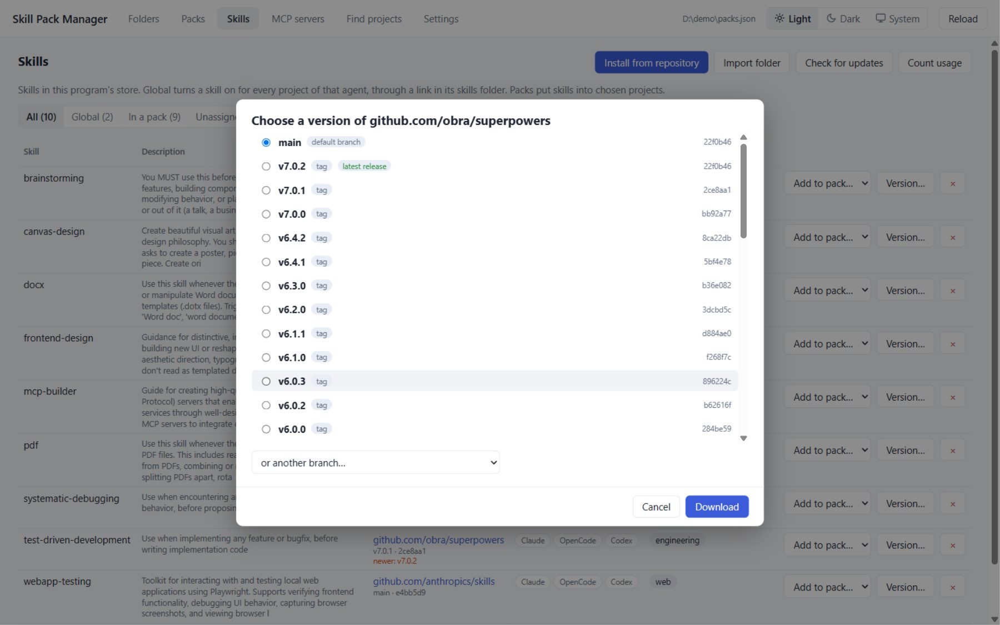
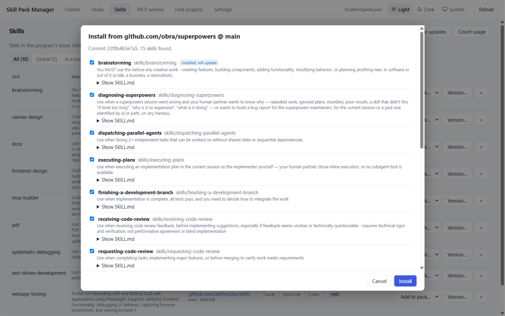
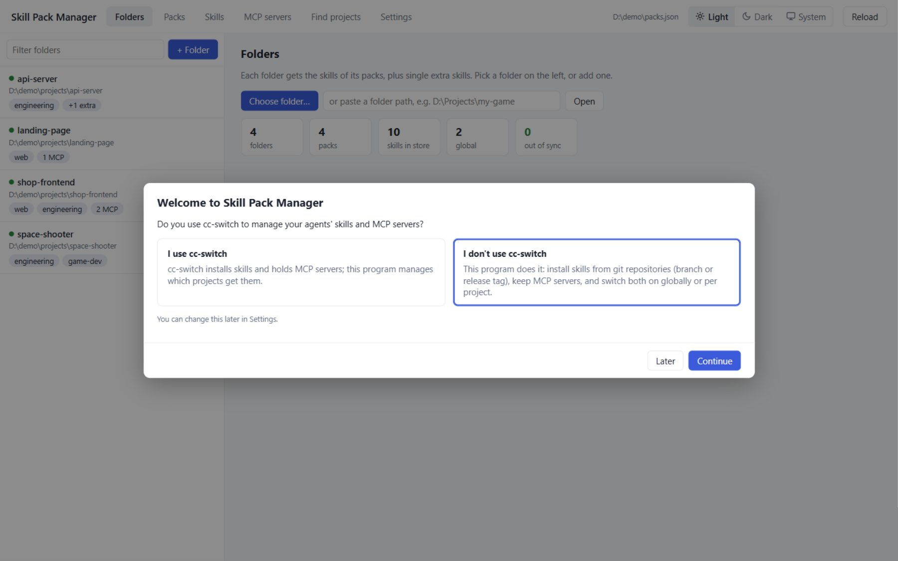
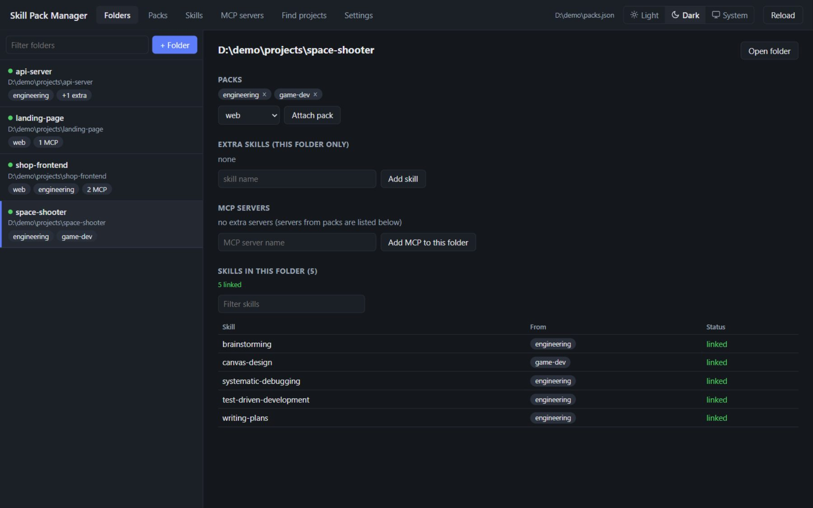
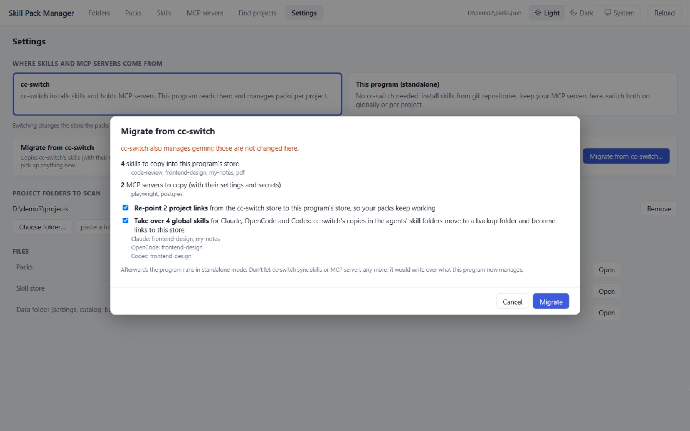

# Skill Pack Manager

Choose which agent skills and MCP servers each project gets, for
**Claude Code**, **OpenCode** and **Codex**. A small desktop app for Windows,
macOS and Linux, with no dependencies beyond Python and git.


## Why

Agents load every global skill's description into every session. With dozens of
skills, most of them for one kind of project (game engines, video, a framework
you use in one repo), that is thousands of tokens of noise everywhere else.

Skill Pack Manager keeps the global set small and puts the rest where it
belongs:

- A **pack** is a named set of skills and MCP servers, such as `web`,
  `game-dev` or `docs`.
- You **attach** packs to project folders. The app links the skills into the
  project's `.claude/skills`, `.opencode/skills` and `.agents/skills`, and adds
  the MCP servers to that project's Claude Code, OpenCode and Codex config.
- **Detach** removes exactly what it added. The project's own files stay as
  they are.

Every change opens a preview of what will be linked, unlinked, added or removed,
in which folder and for which agent. Nothing happens until you press Apply.

## Features

- **Packs per project.** Create packs, attach them to folders, add single extra
  skills or MCP servers to one folder only.
- **Pack routers.** One generated skill (`using-<pack>`, invoked as `/using-<pack>`) that stands in for a
  whole pack: agents see one description instead of one per skill, and the
  router's index tells them which skill to read (the index-skill pattern of
  Unity's agent plugin). Written from a template,
  or by AI through your Claude Code or Codex subscription or an API key.
- **Status per folder.** Each skill and MCP server shows whether it is in place
  for every agent, missing, conflicting with a project file, or left over. One
  click syncs a folder that drifted.
- **Install skills from git** (standalone mode). Paste a repository URL and pick
  the default branch or a release tag. Tags are sorted by version, newest first.
  You see every `SKILL.md` before installing, and the app records the source,
  ref and commit for updates.
- **Where each skill came from.** The Skills tab shows every skill's
  repository, the version in use (branch or release tag, with the commit when
  known) and the folder inside the repository, plus a **GitHub ↗** button that
  opens that exact folder at that version in your browser. In cc-switch mode
  this comes from cc-switch's records. The search box matches the repository too
  (`anthropics/skills`, `github.com/obra`), the version and the path in it.
- **Bulk add and remove.** Tick skills in the Skills tab (or select all that the
  search shows; Shift+click for a range) and add them to a pack or remove them
  from one, with a single preview.
- **Updates.** One button checks every installed skill against its repository:
  new commits on its branch, or newer release tags.
- **MCP catalog** (standalone mode). Add stdio or HTTP/SSE servers with a form,
  or paste the JSON from a server's README (`mcpServers`, OpenCode `mcp`, or
  plain). Secret values are stored locally and never shown again in the UI.
- **Global switches** (standalone mode). Turn a skill or MCP server on for every
  project of one agent, per agent.
- **Find projects.** Scans your project folders for git repositories, Unity,
  Unreal and Godot projects, and folders that already hold linked skills but
  have no pack. Each project's stack (node, react, python, fastapi, rust, ...)
  comes from its marker files, and the app suggests the pack named after that
  stack, or the one used by your projects like it.
- **Usage tab.** Reads past Claude Code, OpenCode and Codex sessions on this
  computer: uses per skill, per agent and per folder, uses per week, and skills
  never used. Skills read through a pack router count too.
- **Context cost.** For every folder and agent, an estimate of the tokens the
  skill listings take in every session (global skills included), and what the
  pack routers save or could save. The Skills tab shows the estimate per skill.
- **Cleanup suggestions.** A global skill nobody used lately, a global skill
  used in one project only, a pack skill or extra skill unused where it is
  attached, a big pack without a router. Each suggestion opens the usual
  preview.
- **Light, dark or system theme.**

## Screenshots

| | |
|---|---|
|  |  |
| **Skills**: source repo, version, update hints, global switches per agent | **Install**: default branch first, then release tags by version |
|  |  |
| **Install**: pick skills, read each SKILL.md first | **MCP servers**: transport, secrets as key names only, global switches |
|  |  |
| **First run**: cc-switch or standalone | **Dark theme** |

## Requirements

- Python 3.12 or newer
- git (for installing skills from repositories)
- The `claude` CLI, if you want MCP servers in Claude Code (the app adds them
  through `claude mcp add-json`, never by editing Claude's config file)
- Optional: Microsoft Edge, Google Chrome or Chromium, for a window without a
  browser address bar. Without one, the app opens in your default browser.

## Install and run

```sh
git clone https://github.com/YogevBokobza/skill-pack-manager.git
cd skill-pack-manager
python -m spm            # on Windows: py -3.12 -m spm
```

Shortcuts:

- **Windows:** `powershell -ExecutionPolicy Bypass -File install-shortcut.ps1`
  adds Desktop and Start menu shortcuts (no console window).
- **Linux:** `sh install-linux.sh` adds an entry to the application menu.
- **macOS:** run `python3 -m spm` from the folder, or create an Automator app
  that runs it.

Or install it as a command: `pip install .` and run `skill-pack-manager`.

### Command line

The same operations work without the window, for scripts, git hooks and agents:

```sh
python -m spm status                     # every folder in packs.json: in sync or not
python -m spm status .                   # one folder, skill by skill
python -m spm attach web ~/Projects/shop # FOLDER defaults to the current folder
python -m spm detach web
python -m spm sync --all
python -m spm extra add stripe-integration
python -m spm pack add web frontend-design webapp-testing
python -m spm tokens                     # estimated context cost per folder and agent
python -m spm usage --count              # read the session logs, then list skill use
python -m spm suggest --days 90          # cleanup suggestions, each with the command that does it
python -m spm scan                       # projects without a pack, with a suggested pack
python -m spm check-updates              # standalone mode
```

A command that changes something prints its plan first. In a terminal it asks
before applying. Elsewhere it applies only with `--yes` and exits with code 2
without it, so an agent can show you the plan before running it again.
`--dry-run` prints the plan only, and `--json` prints machine-readable output.
After `pip install .`, the command is also available as `spm`.

The app starts a local server on `127.0.0.1` and opens its window. The server
runs as long as the window is open, also when the window sits in the
background, and stops a few seconds after you close it. In a regular browser
tab (no Edge or Chrome found) it stops after the tab is closed, or after three
minutes without a sign of life from the page.

## First run: cc-switch or standalone

The app asks once (you can change it later in **Settings**):

| | **cc-switch** | **Standalone** |
|---|---|---|
| Who installs skills | [cc-switch](https://github.com/farion1231/cc-switch) | this app, from git repositories |
| Skill store | `~/.cc-switch/skills` | the app's data folder |
| MCP catalog | cc-switch database (read-only here) | the app's catalog |
| Global on/off | in cc-switch | in this app |
| Packs per project | this app | this app |

Choose cc-switch if you already use it: the app reads its skills and MCP servers
and handles only the per-project part. Choose standalone if you don't: the app
does the whole job.

### Migrating from cc-switch

If cc-switch is on the computer, **Settings** shows **Migrate from cc-switch**.
It is also offered when you pick standalone on first run. The preview lists
every step, and you can turn the last two off:

1. **Skills** are copied from the cc-switch store into the app's store, with
   their GitHub source (owner, repo, branch, path), so **Check for updates** and
   **Version…** keep working. A name already used in the app's store is skipped
   unless you tick *Replace*.
2. **MCP servers** are copied into the catalog with their settings and secrets.
3. **Project links** that point into the cc-switch store are re-pointed to the
   new store, so your packs keep working.
4. **Global skills** that cc-switch enabled for Claude Code, OpenCode or Codex:
   cc-switch's copies in the agents' skill folders move to a backup folder
   (`<data folder>/migration-backup/<time>`) and are replaced with links.

Global MCP entries need no step: cc-switch already wrote them into the agents'
configs, and the catalog recognizes them by name. cc-switch's own files are
never changed, and agents the app does not manage (Gemini, Cursor, ...) are left
alone. The migration refuses to run while cc-switch is open, because cc-switch
rewrites the agents' skill folders; afterwards, stop it from syncing skills and
MCP servers. You can run the migration again later to pick up anything new.



## How to use

1. **Get skills into the store.** In standalone mode, open **Skills**, click
   **Install from repository**, paste a URL such as
   `https://github.com/anthropics/skills`, pick a version, tick the skills you
   want and install. You can also import a local folder that has a `SKILL.md`.
2. **Create a pack.** In **Packs**, type a name (`web`), then add skills and MCP
   servers to it.
3. **Attach the pack to projects.** From the pack, click **Attach folder**, or
   open a folder in **Folders** and pick a pack. Check the preview and apply.
4. **Add one-offs.** In a folder's view, add an extra skill or MCP server that
   only this folder gets.
5. **Keep a small global set.** In standalone mode, switch skills or MCP servers
   on globally per agent in **Skills** or **MCP servers**.
6. **Find what you missed.** **Find projects** lists projects without a pack.
   Set the folders it scans in **Settings**.
7. **Trim what nobody uses.** In **Usage**, click **Count usage**, then go
   through the suggestions. Pick how far back "not used" looks (30 to 180
   days). The context cost table shows what each folder costs per session.
8. **Keep it current.** **Check for updates** in **Skills**, and **Version…** on
   a skill to move to another branch or tag.

### Usage and context cost

**Count usage** reads the session logs the agents keep on this computer. It
counts Skill tool calls and slash commands (Claude Code), the skill tool
(OpenCode), `SKILL.md` reads (Codex), and reads of
`using-<pack>/references/<name>/<name>.md`, which is how agents open a skill
behind a router. Nothing is sent anywhere. Claude Code deletes old session logs
after 30 days by default, so the tab shows how far back the logs go, and "not
used" never claims more than that.

The context cost is an estimate: about four characters per token of each listed
skill's name and description, from the skills folders each agent reads:

| Agent | In a project | Global |
|---|---|---|
| Claude Code | `.claude/skills` | `~/.claude/skills` |
| OpenCode | `.opencode/skills`, `.claude/skills`, `.agents/skills` | `~/.config/opencode/skills`, `~/.claude/skills`, `~/.agents/skills` |
| Codex | `.agents/skills` | `~/.codex/skills`, `~/.agents/skills` |

A skill with `disable-model-invocation: true` is not listed, so it costs
nothing. Built-in skills and skills from plugins are not counted.

### Pack routers

Agents load the description of every skill they can see into every session. A
pack of twenty skills costs twenty descriptions, even in a session that needs
none of them. A router replaces them with one.

The layout follows the index-skill pattern of Unity's agent plugin
([`using-unity`](https://github.com/Unity-Technologies/unity-agent-plugin/blob/main/skills/using-unity/SKILL.md)):
one listed skill whose body indexes the others, which live inside its own
folder.

```
<data folder>/routers/using-web/
  SKILL.md                                  the index
  references/frontend-design/
    frontend-design.md                      copy of the skill's SKILL.md
    references/  scripts/ ...               links to the skill's own folders
  references/webapp-testing/ ...
```

The router's `SKILL.md` has:

- a **description** in the pattern "Index of the web pack's skills, with every
  skill's description and file. Make sure to use this skill for any web task,
  from ... to ..., including advice questions, before writing code or
  answering." It is the only text the agent sees before opening the router, so
  it names every topic in the pack;
- **Step 1: pick one skill**, the one whose description fits the whole request;
- **Step 2: read it and follow it**, with paths relative to the router's folder,
  and a skill's own relative paths (`scripts/...`, `<SKILL_DIR>`) meaning that
  skill's folder;
- **skills that name other skills**: every skill in the index is installed, so a
  skill that says "use the X skill" reads X's file from the index;
- an **index, A to Z**: each skill's own description and its file,
  `references/<name>/<name>.md`.

Each skill's `SKILL.md` is copied as `<name>.md` so agents that scan for
`SKILL.md` files recursively still list only the router. The copies and the
index follow the store: update a skill and the router picks it up.

In a pack, click **Create router…**. The editor fills in the description from a
template; click **Write** to have it written by AI (see below), or edit it. The
index entry of each skill starts as the skill's own description; change one only
to add something the description doesn't say. The router is saved as a skill
named `using-<pack>` (`/using-web` for a pack named `web`), and every folder with the pack gets it.

Each pack chooses a mode:

| Mode | What a project gets |
|---|---|
| **Instead of the skills** (default) | Only the router in `.claude/skills`, `.opencode/skills` and `.agents/skills`. The skills are reached through its index. Saves the tokens; the skills can't be called by name on their own. |
| **Alongside the skills** | The router plus every skill. Helps the agent choose; no savings. |

Adding or removing a skill in the pack updates the router. A description written
by the template is regenerated; one you edited or had written by AI is kept, and
the pack view marks it out of date so you can rewrite it.

**AI writers** (Settings → *Writing pack routers*): Claude Code CLI or Codex CLI
use your subscription (they run with no tools, in an empty folder); Anthropic
or OpenAI use an API key you save in Settings. The writer receives only the
pack's skill names and descriptions and must answer with the description as
JSON; the app builds the router file itself.

### Statuses in a folder

| Skill status | Meaning |
|---|---|
| linked | Wanted by a pack or as an extra, and linked for all three agents |
| not linked yet / partly linked | Wanted, some links missing. **Sync** adds them |
| name conflict | The project has its own folder or link with that name. Left alone |
| linked, no pack wants it | A link from this app that nothing asks for. **Sync** removes it |
| project's own skill | A real folder in the project. Never touched |
| behind the router | Inside the pack's router, reached through its index |

MCP servers use the same states ("configured" instead of "linked"), with a
column per agent.

## How it works

### Where things go

| | Claude Code | OpenCode | Codex |
|---|---|---|---|
| Skills in a project | `.claude/skills/<name>` | `.opencode/skills/<name>` | `.agents/skills/<name>` |
| Skills, global (standalone) | `~/.claude/skills/<name>` | `~/.config/opencode/skills/<name>` | `~/.codex/skills/<name>` |
| MCP in a project | local scope via `claude mcp add-json --scope local` | `.opencode/opencode.json` | `.codex/config.toml` (and the project is marked trusted in `~/.codex/config.toml`) |
| MCP, global (standalone) | user scope via `claude mcp add-json --scope user` | `~/.config/opencode/opencode.json` | `~/.codex/config.toml` |

Skills are **links** to one copy in the store: junctions on Windows (no admin
rights needed), symlinks on macOS and Linux. Updating a skill in the store
updates it everywhere. The links and the project config files the app creates
are added to the repository's `.git/info/exclude`, so they never appear in
`git status`.

### packs.json

Your packs live in `packs.json` in the app folder. It is ignored by git; see
[`packs.example.json`](packs.example.json):

```json
{
  "packs": {
    "web": {
      "skills": ["frontend-design", "playwright-testing"],
      "mcp": ["browser-tools"],
      "paths": ["~/Projects/shop-frontend", "~/Projects/landing-page"]
    }
  },
  "folders": {
    "~/Projects/shop-frontend": { "skills": ["stripe-integration"], "mcp": ["postgres"] }
  }
}
```

`folders` holds the extras for single folders. You can edit the file by hand;
the app reads it on every action. Before each save it keeps a backup of the
previous version (last 50) in the data folder.

### Data folder

| OS | Location |
|---|---|
| Windows | `%LOCALAPPDATA%\skill-pack-manager` |
| macOS | `~/Library/Application Support/skill-pack-manager` |
| Linux | `$XDG_DATA_HOME/skill-pack-manager` (default `~/.local/share/skill-pack-manager`) |

It holds `settings.json`, the standalone store (`store/skills`, `store/catalog.json`),
`packs.json` backups, the usage cache and the log (`spm.log`).

## Safety

- **Only its own changes are undone.** A link is removed only after checking it
  points into the store, and on Windows the removal (`os.rmdir` on the junction)
  cannot delete a folder with content. An MCP entry is removed only when its name
  is in the catalog and its file is not tracked by git. Real folders, other
  links, other MCP entries and any git-tracked config file are reported, never
  changed.
- **Config edits are checked.** Codex TOML is parsed after every edit and rolled
  back if it would break. OpenCode config files with comments (`.jsonc`) are
  never rewritten.
- **Secrets.** MCP env values and headers are written into the agents' config
  files (that is where agents read them) and into the standalone catalog. On
  macOS and Linux the catalog is readable by your user only. The UI and its API
  only ever see key names.
- **Downloads.** Skills are text that goes into your agent's context, so install
  only from sources you trust. Cloning runs no code from the repository: git runs
  with the `ext::` transport disabled, no LFS filters, no symlinks checked out,
  and no prompts.
- **Local only.** The server listens on `127.0.0.1`. Every request needs a token
  created at launch and the exact `Host` header, so web pages in your browser
  cannot call it.

## Configuration

All optional environment variables:

| Variable | Default | Purpose |
|---|---|---|
| `SPM_PACKS` | `<app folder>/packs.json` | packs file |
| `SPM_DATA` | see *Data folder* | settings, store, backups, log |
| `SPM_SCAN_ROOTS` | from Settings | folders for Find projects (`;` on Windows, `:` elsewhere) |
| `SPM_HOME` | your home folder | where agent folders are looked up; for demos and tests |
| `SPM_STORE`, `SPM_DB` | `~/.cc-switch/skills`, `~/.cc-switch/cc-switch.db` | cc-switch locations |
| `SPM_CLAUDE_CLI` | `claude` on `PATH` | Claude Code CLI |
| `SPM_CLAUDE_JSON` | `~/.claude.json` | read to show Claude's MCP state |
| `SPM_CODEX_GLOBAL` | `~/.codex/config.toml` | Codex global config |
| `SPM_OPENCODE_DIR` | `~/.config/opencode` | OpenCode global config folder |

## Development

```sh
python -m unittest -v           # all tests, Windows, macOS and Linux
python -m spm --no-window       # serve only, print the URL
python tools/make_demo.py /tmp/spm-demo   # a sandbox with made-up projects
```

See [CONTRIBUTING.md](CONTRIBUTING.md) for the layout and the ground rules.

## License

[MIT](LICENSE)
