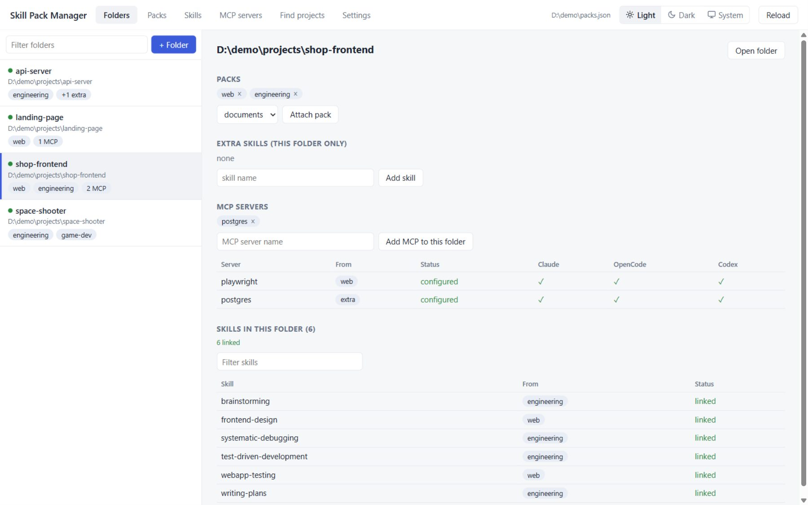
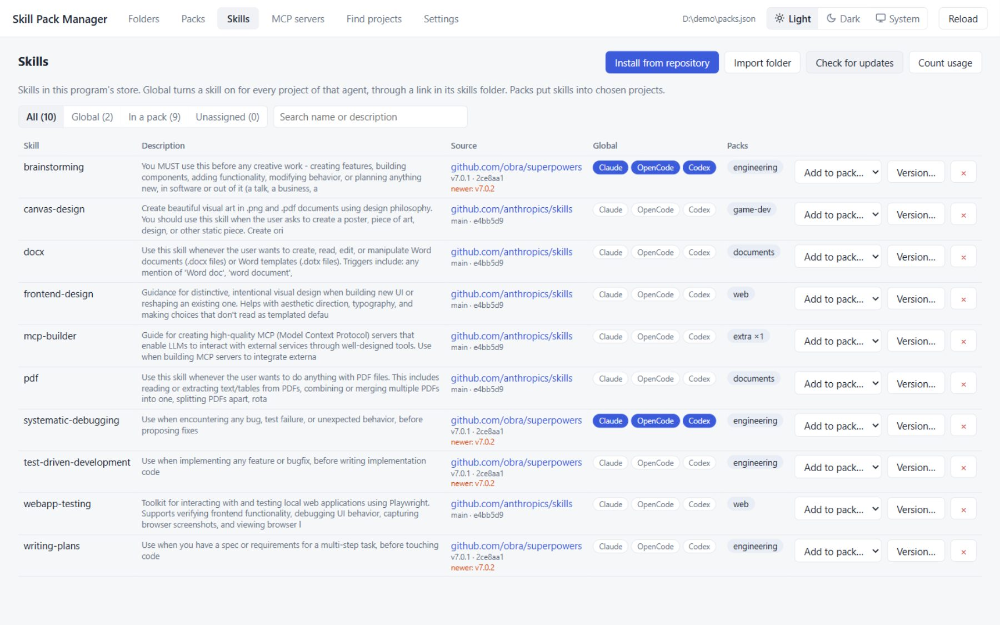
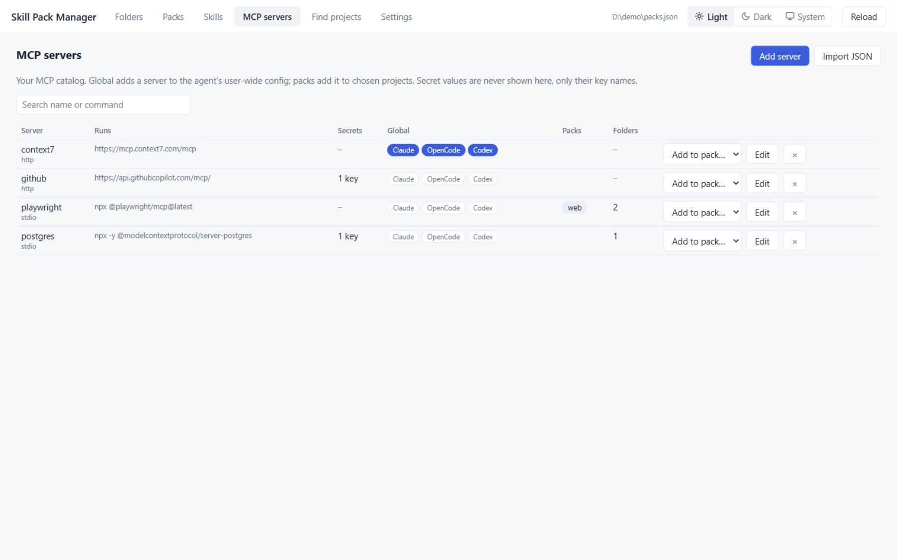

# Skill Pack Manager

Choose which agent skills and MCP servers each project gets, for
**Claude Code**, **OpenCode** and **Codex**. A small desktop app for Windows,
macOS and Linux, with no dependencies beyond Python and git.



## Why

Agents load every global skill's description into every session. With dozens of
skills, most of them for one kind of project (game engines, video, a framework
you use in one repo), that is thousands of tokens of noise everywhere else.

Skill Pack Manager keeps the global set small and puts the rest where it
belongs:

- A **pack** is a named set of skills and MCP servers, such as `web`,
  `game-dev` or `docs`.
- You **attach** packs to project folders. The app links the skills into the
  project's `.claude/skills`, `.opencode/skills` and `.agents/skills`, and adds
  the MCP servers to that project's Claude Code, OpenCode and Codex config.
- **Detach** removes exactly what it added. The project's own files stay as
  they are.

Every change opens a preview of what will be linked, unlinked, added or removed,
in which folder and for which agent. Nothing happens until you press Apply.

## Features

- **Packs per project.** Create packs, attach them to folders, add single extra
  skills or MCP servers to one folder only.
- **Status per folder.** Each skill and MCP server shows whether it is in place
  for every agent, missing, conflicting with a project file, or left over. One
  click syncs a folder that drifted.
- **Install skills from git** (standalone mode). Paste a repository URL and pick
  the default branch or a release tag. Tags are sorted by version, newest first.
  You see every `SKILL.md` before installing, and the app records the source,
  ref and commit for updates.
- **Updates.** One button checks every installed skill against its repository:
  new commits on its branch, or newer release tags.
- **MCP catalog** (standalone mode). Add stdio or HTTP/SSE servers with a form,
  or paste the JSON from a server's README (`mcpServers`, OpenCode `mcp`, or
  plain). Secret values are stored locally and never shown again in the UI.
- **Global switches** (standalone mode). Turn a skill or MCP server on for every
  project of one agent, per agent.
- **Find projects.** Scans your project folders for Unity and Unreal projects
  and for folders that already hold linked skills but have no pack.
- **Usage counts.** Reads past Claude Code, OpenCode and Codex sessions to show
  how often each skill was used and where.
- **Light, dark or system theme.**

## Screenshots

| | |
|---|---|
|  |  |
| **Skills**: source repo, version, update hints, global switches per agent | **Install**: default branch first, then release tags by version |
|  |  |
| **Install**: pick skills, read each SKILL.md first | **MCP servers**: transport, secrets as key names only, global switches |
|  |  |
| **First run**: cc-switch or standalone | **Dark theme** |

## Requirements

- Python 3.12 or newer
- git (for installing skills from repositories)
- The `claude` CLI, if you want MCP servers in Claude Code (the app adds them
  through `claude mcp add-json`, never by editing Claude's config file)
- Optional: Microsoft Edge, Google Chrome or Chromium, for a window without a
  browser address bar. Without one, the app opens in your default browser.

## Install and run

```sh
git clone https://github.com/<you>/skill-pack-manager.git
cd skill-pack-manager
python -m spm            # on Windows: py -3.12 -m spm
```

Shortcuts:

- **Windows:** `powershell -ExecutionPolicy Bypass -File install-shortcut.ps1`
  adds Desktop and Start menu shortcuts (no console window).
- **Linux:** `sh install-linux.sh` adds an entry to the application menu.
- **macOS:** run `python3 -m spm` from the folder, or create an Automator app
  that runs it.

Or install it as a command: `pip install .` and run `skill-pack-manager`.

The app starts a local server on `127.0.0.1` and opens its window. It exits
about 30 seconds after you close the window.

## First run: cc-switch or standalone

The app asks once (you can change it later in **Settings**):

| | **cc-switch** | **Standalone** |
|---|---|---|
| Who installs skills | [cc-switch](https://github.com/farion1231/cc-switch) | this app, from git repositories |
| Skill store | `~/.cc-switch/skills` | the app's data folder |
| MCP catalog | cc-switch database (read-only here) | the app's catalog |
| Global on/off | in cc-switch | in this app |
| Packs per project | this app | this app |

Choose cc-switch if you already use it: the app reads its skills and MCP servers
and handles only the per-project part. Choose standalone if you don't: the app
does the whole job.

## How to use

1. **Get skills into the store.** In standalone mode, open **Skills**, click
   **Install from repository**, paste a URL such as
   `https://github.com/anthropics/skills`, pick a version, tick the skills you
   want and install. You can also import a local folder that has a `SKILL.md`.
2. **Create a pack.** In **Packs**, type a name (`web`), then add skills and MCP
   servers to it.
3. **Attach the pack to projects.** From the pack, click **Attach folder**, or
   open a folder in **Folders** and pick a pack. Check the preview and apply.
4. **Add one-offs.** In a folder's view, add an extra skill or MCP server that
   only this folder gets.
5. **Keep a small global set.** In standalone mode, switch skills or MCP servers
   on globally per agent in **Skills** or **MCP servers**.
6. **Find what you missed.** **Find projects** lists projects without a pack.
   Set the folders it scans in **Settings**.
7. **Keep it current.** **Check for updates** in **Skills**, and **Version…** on
   a skill to move to another branch or tag.

### Statuses in a folder

| Skill status | Meaning |
|---|---|
| linked | Wanted by a pack or as an extra, and linked for all three agents |
| not linked yet / partly linked | Wanted, some links missing. **Sync** adds them |
| name conflict | The project has its own folder or link with that name. Left alone |
| linked, no pack wants it | A link from this app that nothing asks for. **Sync** removes it |
| project's own skill | A real folder in the project. Never touched |

MCP servers use the same states ("configured" instead of "linked"), with a
column per agent.

## How it works

### Where things go

| | Claude Code | OpenCode | Codex |
|---|---|---|---|
| Skills in a project | `.claude/skills/<name>` | `.opencode/skills/<name>` | `.agents/skills/<name>` |
| Skills, global (standalone) | `~/.claude/skills/<name>` | `~/.config/opencode/skills/<name>` | `~/.codex/skills/<name>` |
| MCP in a project | local scope via `claude mcp add-json --scope local` | `.opencode/opencode.json` | `.codex/config.toml` (and the project is marked trusted in `~/.codex/config.toml`) |
| MCP, global (standalone) | user scope via `claude mcp add-json --scope user` | `~/.config/opencode/opencode.json` | `~/.codex/config.toml` |

Skills are **links** to one copy in the store: junctions on Windows (no admin
rights needed), symlinks on macOS and Linux. Updating a skill in the store
updates it everywhere. The links and the project config files the app creates
are added to the repository's `.git/info/exclude`, so they never appear in
`git status`.

### packs.json

Your packs live in `packs.json` in the app folder. It is ignored by git; see
[`packs.example.json`](packs.example.json):

```json
{
  "packs": {
    "web": {
      "skills": ["frontend-design", "playwright-testing"],
      "mcp": ["browser-tools"],
      "paths": ["~/Projects/shop-frontend", "~/Projects/landing-page"]
    }
  },
  "folders": {
    "~/Projects/shop-frontend": { "skills": ["stripe-integration"], "mcp": ["postgres"] }
  }
}
```

`folders` holds the extras for single folders. You can edit the file by hand;
the app reads it on every action. Before each save it keeps a backup of the
previous version (last 50) in the data folder.

### Data folder

| OS | Location |
|---|---|
| Windows | `%LOCALAPPDATA%\skill-pack-manager` |
| macOS | `~/Library/Application Support/skill-pack-manager` |
| Linux | `$XDG_DATA_HOME/skill-pack-manager` (default `~/.local/share/skill-pack-manager`) |

It holds `settings.json`, the standalone store (`store/skills`, `store/catalog.json`),
`packs.json` backups, the usage cache and the log (`spm.log`).

## Safety

- **Only its own changes are undone.** A link is removed only after checking it
  points into the store, and on Windows the removal (`os.rmdir` on the junction)
  cannot delete a folder with content. An MCP entry is removed only when its name
  is in the catalog and its file is not tracked by git. Real folders, other
  links, other MCP entries and any git-tracked config file are reported, never
  changed.
- **Config edits are checked.** Codex TOML is parsed after every edit and rolled
  back if it would break. OpenCode config files with comments (`.jsonc`) are
  never rewritten.
- **Secrets.** MCP env values and headers are written into the agents' config
  files (that is where agents read them) and into the standalone catalog. On
  macOS and Linux the catalog is readable by your user only. The UI and its API
  only ever see key names.
- **Downloads.** Skills are text that goes into your agent's context, so install
  only from sources you trust. Cloning runs no code from the repository: git runs
  with the `ext::` transport disabled, no LFS filters, no symlinks checked out,
  and no prompts.
- **Local only.** The server listens on `127.0.0.1`. Every request needs a token
  created at launch and the exact `Host` header, so web pages in your browser
  cannot call it.

## Configuration

All optional environment variables:

| Variable | Default | Purpose |
|---|---|---|
| `SPM_PACKS` | `<app folder>/packs.json` | packs file |
| `SPM_DATA` | see *Data folder* | settings, store, backups, log |
| `SPM_SCAN_ROOTS` | from Settings | folders for Find projects (`;` on Windows, `:` elsewhere) |
| `SPM_HOME` | your home folder | where agent folders are looked up; for demos and tests |
| `SPM_STORE`, `SPM_DB` | `~/.cc-switch/skills`, `~/.cc-switch/cc-switch.db` | cc-switch locations |
| `SPM_CLAUDE_CLI` | `claude` on `PATH` | Claude Code CLI |
| `SPM_CLAUDE_JSON` | `~/.claude.json` | read to show Claude's MCP state |
| `SPM_CODEX_GLOBAL` | `~/.codex/config.toml` | Codex global config |
| `SPM_OPENCODE_DIR` | `~/.config/opencode` | OpenCode global config folder |

## Development

```sh
python -m unittest -v           # 53 tests, Windows, macOS and Linux
python -m spm --no-window       # serve only, print the URL
python tools/make_demo.py /tmp/spm-demo   # a sandbox with made-up projects
```

See [CONTRIBUTING.md](CONTRIBUTING.md) for the layout and the ground rules.

## License

[MIT](LICENSE)
